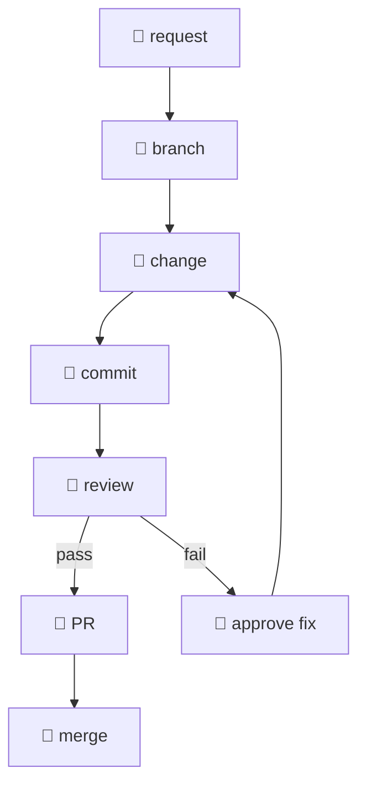

# claudeflow

My prudent Claude Code setup for personal projects and work.



## How it works

- **Rules**: each session starts with the rules in [CLAUDE.md](CLAUDE.md).
  - Approval gates, shell habits, git conventions, and technical writing style.
  - R, Python, and data preferences.
- **Skills:** research writing style, visualization, and secrets when a task needs them.
- **Approvals**: 
  - I approve each commit, pull request, and merge.
  - Claude cannot commit to the default branch.
- **CLIs**: I approve each call to a sensitive CLI, such as `az`, `sf`, or `curl`.
- **Destructive commands**: I approve of destructive commands via dcg.
- **Reviews**: 
  - roborev reviews each commit in the background.
  - Claude fixes the findings when I approve.
- **Secrets** stay out of the logs.
  - Claude runs each command that needs a secret through dotenvx, which redacts the output.
  - At the end of each session, a hook redacts the keys that trufflehog finds in the transcripts.
- **Logs** older than 7 days are deleted.
- **Status line** includes:
  - Model, working directory, Caveman mode, context, and plan use.
  - Azure subscription and Salesforce org after Claude uses them.

## Install

Requirements:

- macOS 15 or later, for the `trash` command.
- Claude Code v2.1.285 or later.
- `jq`, `python3`, `git`, Homebrew, and `uv`.

Download the files to `~/.claude`:

```
base=https://raw.githubusercontent.com/dylanpieper/claudeflow/main
for f in CLAUDE.md statusline.sh hooks/{git-commit,gh-pr,git-merge}-guard.sh hooks/md-list-check.sh hooks/{transcript-redact,cli-guard}.py \
  rules/{r,python,data,roborev}.md \
  skills/{research-writing,viz,dotenvx}/SKILL.md \
  skills/viz/references/{r,grammar-style,python,web}.md dcg/packs/{macos,duckdb}.yaml; do
  curl -fsSL --create-dirs "$base/$f" -o ~/.claude/$f
done
chmod +x ~/.claude/hooks/*.sh
```

Merge this into `~/.claude/settings.json`. The hooks and the status line need `jq`.
The `pluginConfigs` entry makes Claude read `AGENTS.md` with `CLAUDE.md` (Claude Code v2.1.285 or later).

```
{
  "statusLine": { "type": "command", "command": "bash ~/.claude/statusline.sh" },
  "hooks": {
    "PreToolUse": [
      {
        "matcher": "Bash",
        "hooks": [
          {
            "type": "command",
            "if": "Bash(git *)",
            "command": "$HOME/.claude/hooks/git-commit-guard.sh",
            "timeout": 10
          },
          { "type": "command", "command": "$HOME/.claude/hooks/gh-pr-guard.sh", "timeout": 10 },
          { "type": "command", "command": "$HOME/.claude/hooks/git-merge-guard.sh", "timeout": 10 },
          { "type": "command", "command": "python3 $HOME/.claude/hooks/cli-guard.py", "timeout": 10 }
        ]
      },
      {
        "matcher": "Bash|PowerShell|Monitor",
        "hooks": [{ "type": "command", "command": "$HOME/.local/bin/dcg" }]
      }
    ],
    "PostToolUse": [
      {
        "matcher": "Write|Edit",
        "hooks": [{ "type": "command", "command": "$HOME/.claude/hooks/md-list-check.sh", "timeout": 10 }]
      }
    ],
    "SessionEnd": [
      { "hooks": [{ "type": "command", "command": "python3 $HOME/.claude/hooks/transcript-redact.py", "timeout": 5 }] }
    ]
  },
  "pluginConfigs": {
    "cc-plugin-agents-md@builtin": {
      "options": { "instructionFiles": "claude-md-and-agents-md" }
    }
  },
  "enableArtifact": false,
  "autoMemoryEnabled": false
}
```

`enableArtifact` turns off the Artifact tool. `autoMemoryEnabled` turns off auto-memory.
After you turn off auto-memory, move the old memory folders to the Trash once.
The first command lists the folders. The second command moves them to the Trash.

```
find ~/.claude/projects -mindepth 2 -maxdepth 2 -type d -name memory
find ~/.claude/projects -mindepth 2 -maxdepth 2 -type d -name memory -exec trash {} +
```

The `trash` command is part of macOS 15 or later.

Block direct pushes to the default branch in each repository.
On the free plan, GitHub does not enforce this on private repositories.

```
gh api repos/{owner}/{repo}/rulesets --method POST --input - <<'EOF'
{
  "name": "protect-main",
  "target": "branch",
  "enforcement": "active",
  "conditions": { "ref_name": { "include": ["~DEFAULT_BRANCH"], "exclude": [] } },
  "rules": [
    { "type": "deletion" },
    { "type": "non_fast_forward" },
    {
      "type": "pull_request",
      "parameters": {
        "required_approving_review_count": 0,
        "dismiss_stale_reviews_on_push": false,
        "require_code_owner_review": false,
        "require_last_push_approval": false,
        "required_review_thread_resolution": false
      }
    }
  ]
}
EOF
```

Install [destructive_command_guard](https://github.com/Dicklesworthstone/destructive_command_guard) (`dcg`) v0.15.3.
It guards destructive shell commands.

- `--no-configure` stops the installer from changing `settings.json`, other agents, and shell rc files.
  Add the `dcg` entry in the JSON above yourself.
- `--verify` runs a self-test after the install.

```
curl -fsSL https://raw.githubusercontent.com/Dicklesworthstone/destructive_command_guard/v0.15.3/install.sh \
  | bash -s -- --version v0.15.3 --no-configure --verify
```

The binary goes to `~/.local/bin/dcg`. Make sure that this folder is on your `PATH`.

By default, dcg blocks each match and turns on only the core, git, and disk packs. Put this in `~/.config/dcg/config.toml`.

- `default_mode = "ask"` asks for approval on each match, including critical rules.
- The `deny` rules always block a recursive delete of `/` or `~`, `git reset --hard`, and each form of force push.
- `enabled` turns on the packs for CI/CD, cloud, containers, databases, platforms, remote copy, storage, and system tools.
- `custom_paths` loads the [macOS and DuckDB packs](dcg/packs/) in this repo, because dcg has neither.

```
[policy]
default_mode = "ask"

[policy.rules]
"core.filesystem:rm-rf-root-home" = "deny"
"core.filesystem:rm-r-f-separate-root-home" = "deny"
"core.filesystem:rm-recursive-force-root-home" = "deny"
"core.git:reset-hard" = "deny"
"core.git:push-force-long" = "deny"
"core.git:push-force-short" = "deny"
"core.git:push-force-refspec" = "deny"

[packs]
enabled = ["cicd", "cloud", "containers", "core", "database", "platform", "remote", "storage", "system"]
custom_paths = ["~/.claude/dcg/packs/*.yaml"]
```

dcg has no setting that denies all critical rules and asks for the rest.
Run `dcg explain --format json '<command>'` and read `outcome` to see what a command does.

dcg rewrites its own hook entry in `settings.json` each time it runs (`self_heal_hook`).
It moves the entry to the top of `PreToolUse` and changes `$HOME` to an absolute path.

Tools and plugins:

```
brew install gh kenn-io/tap/roborev
uv tool install data-dict-yaml
uv tool install air-formatter
roborev agent-hook install
roborev skills install

claude plugin marketplace add anthropics/claude-plugins-official
claude plugin install superpowers@claude-plugins-official
claude plugin marketplace add JuliusBrussee/caveman
claude plugin install caveman@caveman
claude plugin marketplace add duckdb/duckdb-skills
claude plugin install duckdb-skills@duckdb-skills
claude plugin marketplace add ab604/claude-code-r-skills
claude plugin install r-skills@r-skills
claude plugin marketplace add posit-dev/skills
claude plugin install r-lib@posit-dev-skills
claude plugin install quarto@posit-dev-skills
claude plugin install shiny@posit-dev-skills
claude plugin marketplace add wdm0006/python-skills
claude plugin install python-library-foundations@dev-skills
claude plugin marketplace add EmilHvitfeldt/slidecrafting-book.com
claude plugin install slidecrafting@slidecrafting
```

Run `roborev init` in each repository that you want to review.

## Secrets and logs

Session transcripts in `~/.claude/projects/` keep secrets as plain text.
The dotenvx skill runs each command as `dotenvx run --redact -- <command>`.
Do not use `dotenvx run -- claude`: the model and the transcript get the plain values.

[claude-log-cleaner](https://github.com/andrewm4894/claude-log-cleaner) v2.8.0 deletes files older than 7 days at each session end.
It deletes from `debug/`, `file-history/` (rewind history), `plans/`, `projects/` (transcripts), `shell-snapshots/`, and `todos/`.
The files do not go to the Trash.
Set the retention before you install (default 24 hours).
If the config file exists, change only `retention_hours`.

```
curl -sfS "https://dotenvx.sh?version=2.38.0" | sh
brew install trufflehog
[ -f ~/.claude/log-cleaner-config.json ] || echo '{"retention_hours": 168, "clean_on_session_end": true, "dry_run": false}' > ~/.claude/log-cleaner-config.json
claude plugin marketplace add andrewm4894/claude-log-cleaner
claude plugin install log-cleaner@log-cleaner-marketplace
```

At each session end, `transcript-redact.py` replaces the secrets that trufflehog finds in the transcripts with `[REDACTED:<detector>]`.
It scans the transcript of the session and the transcripts of the same project changed in the last day (tested with TruffleHog v3.99.2).
